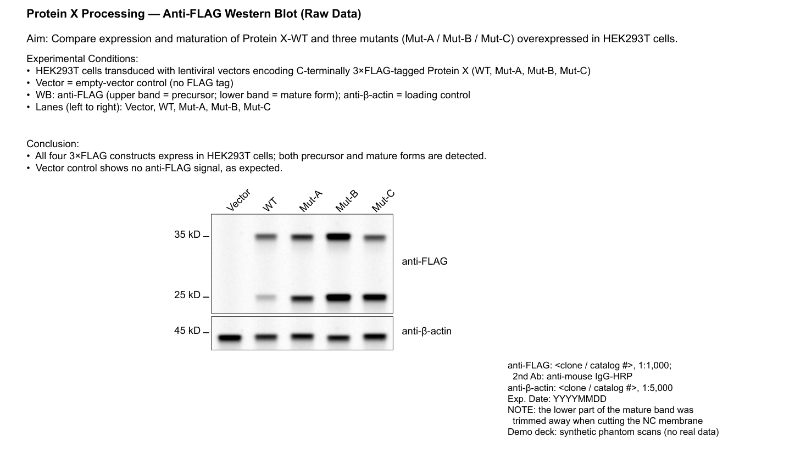

# WB2PPT — Raw Western Blot → Editable PPT

Turn a folder of raw gel-imager exports (ECL exposure series + membrane/marker photo) into a
polished, **fully editable** lab-meeting PPT slide — plus an HTML preview with identical
geometry. Built as an agent skill (the whole workflow is documented in [`SKILL.md`](SKILL.md)).



*Demo output (synthetic phantom scans, no real data).*

## Install (one click per harness)

The repo **is** the skill — cloning it is enough. `install.sh` just puts it where your harness looks:

```bash
git clone https://github.com/operoncao123/WB2PPT.git
cd WB2PPT
bash install.sh            # auto-installs into every harness detected on this machine
bash install.sh --deps     # also pip-install the python dependencies
```

| Harness | Command | Result |
| --- | --- | --- |
| Claude Code | `bash install.sh --claude` | `~/.claude/skills/raw-western-blot-to-ppt` — auto-discovered; just say “把WB数据整理成PPT” |
| ZCode | `bash install.sh --zcode` | `~/.zcode/skills/raw-western-blot-to-ppt` |
| openskills / `.agents` | `bash install.sh --agents` | `~/.agents/skills/...` |
| Codex CLI | `bash install.sh --codex` | `~/.codex/skills/...` |
| Project-level | `bash install.sh --project /path/to/repo` | `<repo>/.claude/skills/...` (committed with the project) |
| Codex / Cursor / Windsurf / Cline / Copilot (rule files) | `bash install.sh --rule-file ~/.codex/AGENTS.md` | appends an instruction snippet pointing at the skill (`.cursorrules`, `.clinerules`, `.github/copilot-instructions.md` …) |

`install.sh` is idempotent — re-running after `git pull` updates existing installs. The skill is
the standard `SKILL.md` format, so any harness that reads skills natively can also just point at
the cloned folder.

Run-time python deps: `pip install -r requirements.txt` (numpy, scipy, pillow, pyyaml,
python-pptx, lxml, pymupdf). LibreOffice is optional — only the QA render step uses it.

## What it does

- **Lane & band analysis** — detects lanes (with cross-panel grid QC so weak lanes don't
  silently vanish), ladder rungs, per-lane band positions and saturation.
- **Molecular-weight calibration** — semi-log ladder assignment validated by protein anchors
  (e.g. actin = 42 kDa) and cross-strip cut-position consistency.
- **Band leveling** — measures each band row's tilt and rotates the raw scan flat before
  cropping (no more tilted lanes in the final figure).
- **Panel crops** — non-merged ECL channels only, percentile contrast stretch, equal
  lane-fraction cropping so stacked panels line up.
- **Deck building** — native PPTX text boxes (title / aim / conditions / conclusion, MW labels
  + tick lines, rotated sample names, antibody info block) + mirrored HTML preview.
- **QA loop** — LibreOffice render → geometry/lane-alignment checks → visual judge.

## Usage

```bash
# 1) analyze a scan (lanes, bands, ladder assignment)
python3 scripts/analyze_scan.py --ecl IM000001_anti-Cas9_super_long.Tif \
    --marker IM000002_anti-Cas9_marker.Tif --lanes 4 \
    --out blot_map.json --overlay overlay.png

# 2) level tilted band rows
python3 scripts/level_bands.py --src RAW_ECL.Tif --out rotated.tif \
    --row "1055,1110:862,959,1056,1153" --json level.json

# 3) crop panels + build the deck
python3 scripts/make_crops.py --src rotated.tif --box 645,1020,1195,1320 --out panel.png
python3 scripts/build_deck.py --spec spec.yaml --ppt WB.pptx --html WB.html
bash scripts/qa_render.sh WB.pptx out/qa
```

`spec.yaml` schema is documented in [`SKILL.md`](SKILL.md). Intended to be driven end-to-end
by a coding agent that follows `SKILL.md` (inventory → analysis → one consolidated question
round → crops → build → QA), but every script is usable standalone.

## Scripts

| script | purpose |
| --- | --- |
| `analyze_scan.py` | membrane extent, ladder dips, lanes, bands, ladder assignment |
| `check_lane_grid.py` | cross-panel lane-grid QC (catches drifting even-split windows) |
| `level_bands.py` | measure band-row tilt, rotate raw scans level, verify |
| `make_crops.py` | contrast-normalized panel crops from raw ECL channels |
| `build_deck.py` | spec.yaml → editable PPTX + HTML preview |
| `qa_render.sh` | render slides to PNG for QA |

## Notes

- Screenshots must come from **un-merged** ECL channels (never from composite exports).
- Handles the real-world mess: cut membrane strips, partially visible ladders, overexposed
  marker photos, empty control lanes, WPS/LibreOffice shape shadows.
